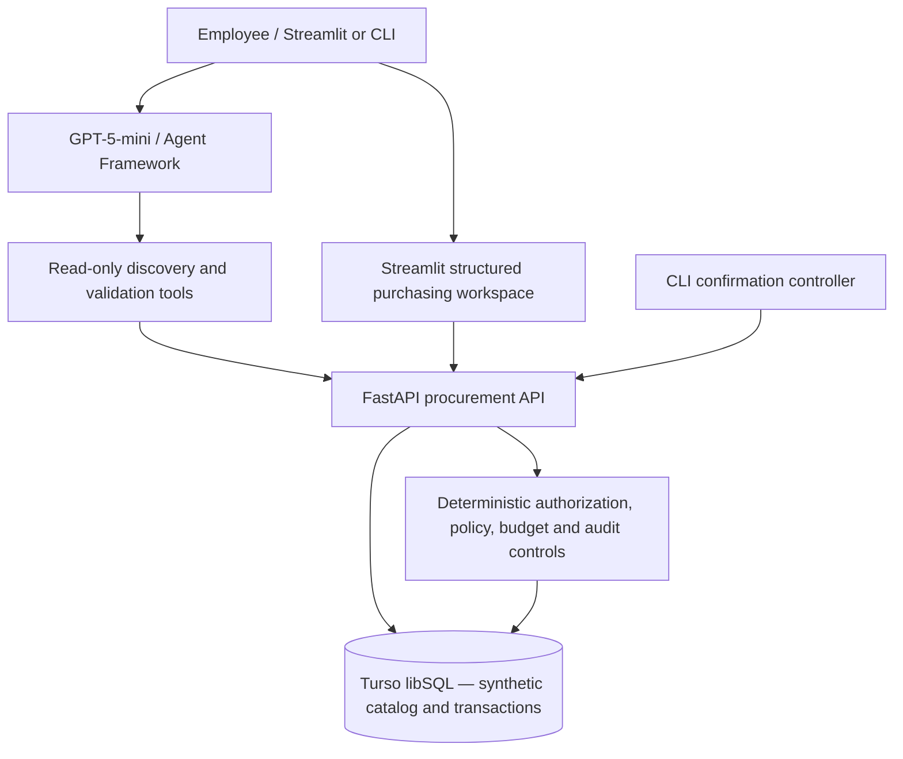

# ProcureAI — Enterprise Agentic AI Procurement Assistant

> Portfolio prototype | Synthetic data | Local development | Work in progress

ProcureAI demonstrates how an AI assistant can move from natural-language procurement requests to **governed, auditable enterprise actions**. An LLM helps users discover materials and compare suppliers; deterministic backend services enforce contract eligibility, budgets, approval routing, and transaction integrity.

## Current capabilities (verified in local testing)

- Natural-language material discovery via GPT-5-mini and Microsoft Agent Framework tools.
- Active-material catalog and supplier-offer retrieval, filtered by supplier and contract eligibility.
- Read-only purchase validation against budget and approval policy.
- Backend requisition creation with explicit confirmation, idempotency, budget commitment and audit entries.
- Backend approval/rejection workflows; rejection releases committed budget.
- Local CLI submission workflow with explicit `YES` confirmation.
- Local Streamlit Stage 2 workspace for material search, supplier selection, quantity and purchase validation; conversational assistant also available.

**Not yet implemented in the Streamlit interface:** chat-embedded transactional selections, requisition confirmation, and manager approval actions. **Not production-ready:** real end-user authentication, deployment hardening, integration with an actual ERP, and comprehensive automated testing.

## Architecture at a glance



The application is designed to keep **model-generated language separate from authorized changes to business state**. Backend API checks—not the assistant's prose—determine whether a requisition can be written.

## Repository layout

```text
ProcureAI/
├── agents/                 # AI agent and CLI requisition controller
├── api/                    # FastAPI, requisitions, approvals
├── database/               # Schema and synthetic seed scripts
├── product/                # Product vision, discovery and PRD
├── docs/                   # Architecture, workflows, governance, decisions, tests, log
├── app.py                  # Streamlit Stage 2 UI
├── README.md
├── requirements.txt
└── .env.example            # Template only; NEVER commit real .env
```

## Local setup (illustrative; verify package versions against requirements.txt)

1. Create and activate a Python virtual environment, then install `requirements.txt`.
2. Copy `.env.example` to `.env` and set local development configuration. **Never commit `.env`.**
3. Authenticate to Azure using the Azure CLI (`az login`) if your credential configuration requires it.
4. Initialize a **development-only** Turso database using the existing schema/seed scripts. **Reset scripts destroy seedable data; never run on production.**
5. Launch FastAPI: `python -m uvicorn api.main:app --reload --host 127.0.0.1 --port 8000`.
6. Launch Streamlit in another terminal: `python -m streamlit run app.py`.
7. Use Streamlit at `http://localhost:8501` and FastAPI docs at `http://127.0.0.1:8000/docs`.

## Demo scenario

1. Search `helmet` and select **MAT-1001**, Industrial Safety Helmet, Type I.
2. Compare **OFF-1002** (IndustrialSource, $23.50, seven days) and **OFF-1001** (SafeGuard Supplies, $25.00, five days).
3. Set quantity **10**; validate a **$235.00** line amount against budget and policy (subject to current database balances).
4. Changing quantity invalidates prior validation in the Stage 2 UI.
5. Separately, the CLI or backend API can submit a requisition after explicit confirmation. Requisition creation is **not yet wired into Streamlit**.

## Evidence and roadmap

See [Test Scenarios](docs/Test-Scenarios.md) for manual test evidence and [Development Log](docs/Development-Log.md) for milestones. See [Agent Workflow](docs/Agent-Workflow.md) for current-vs-target behavior and [AI Governance](docs/AI-Governance.md) for limitations.

## Important disclaimer

ProcureAI uses **synthetic materials, employees, suppliers, policies and budgets**. It is a product/engineering portfolio demonstration, not a production purchasing service or a live connection to SAP/Ariba/Maximo.
