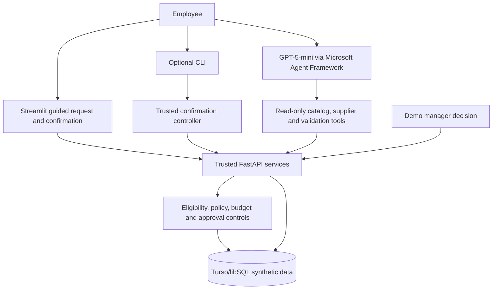

# ProcureAI — Governed Agentic AI Procurement Assistant

**Principal AI Product Manager portfolio case study | V1 local proof of concept | Synthetic data**

ProcureAI explores a practical enterprise AI product question: **How can an AI assistant help employees prepare purchase requisitions while keeping authorization, financial controls, and transaction execution in trusted systems?**

The prototype supports material discovery, contracted supplier comparison, budget and approval-policy validation, and a controlled purchase-requisition workflow. It pairs an Azure-hosted GPT-5-mini agent with deterministic FastAPI services and a Turso/libSQL database containing synthetic procurement data.

> **Scope:** Local educational/portfolio demonstration. ProcureAI is **not** a production procurement system and does **not** connect to live SAP, Ariba, Maximo, suppliers, or payment services.

## Product opportunity

Employees may need to navigate several procurement steps to find the right material, compare eligible suppliers, understand budgets, and obtain approvals. ProcureAI tests a conversational and guided purchasing experience without delegating financial authorization to a language model.

**Target users:** Employees/requesters, procurement specialists, purchasing managers/approvers, and budget owners. The business benefits—such as time saved and improved catalog accuracy—remain **hypotheses** until measured against a comparable baseline.

## V1 capabilities demonstrated

- **Material discovery:** Find active catalog items and present alternatives when the requirement is ambiguous.
- **Supplier comparison:** Retrieve eligible contracted supplier offers with price, currency, and delivery lead time.
- **Read-only AI tools:** The agent can call `search_catalog`, `get_supplier_offers`, and `validate_procurement_request`. These agent tools cannot create or approve a requisition.
- **Authoritative validation:** FastAPI verifies supplier and contract eligibility, amount, available budget, and approval policy.
- **Guided Streamlit purchasing:** Select material and offer, specify quantity, review the validated purchase, and explicitly confirm submission.
- **Trusted submission:** Backend requisition creation uses idempotency and transactional budget controls, with audit records.
- **Manager decision:** A separate **local demonstration** view supports approval or rejection through the backend. This view uses configured synthetic identities; it is **not** authenticated enterprise role-based access control.
- **CLI alternative:** A trusted terminal controller supports `submit OFFER_ID QUANTITY` followed by explicit `YES` confirmation.

**Important UX distinction:** The Streamlit purchasing journey uses a guided workflow, including some deterministic intent handling; not every chat utterance is routed to the LLM. The standalone agent/CLI demonstrates tool-using conversational behavior.

## Architecture and governance



**Design principle:** The model interprets requests and retrieves verified information; **the backend—not model-generated text—controls financial state, approval decisions, and auditing**. Validation is not submission, and employee confirmation does not substitute for manager authorization.

For deeper implementation details, see [Architecture](docs/Architecture.md), [AI Governance](docs/AI-Governance.md), and [Agent Workflow](docs/Agent-Workflow.md).

## Verified end-to-end demonstration

A local development demonstration completed the following scenario:

| Step | Verified behavior |
|---|---|
| Request | 40 industrial safety helmets |
| Material | `MAT-1001` — Industrial Safety Helmet, Type I |
| Selected offer | `OFF-1002` — IndustrialSource |
| Unit price | $23.50 |
| Total | **$940.00** |
| Validation | `APPROVAL_REQUIRED` under the demo's $500 approval threshold |
| Submission | Requisition created with **40 units**, status `PENDING_APPROVAL` |
| Manager action | Synthetic assigned manager approved the request |
| Final database state | **40 units, $940.00, `APPROVED`** |

A UI quantity-state defect was discovered during testing: an early version validated 40 units but submitted one. The defect was corrected, and the final requisition quantity and amount were verified directly in the database. This is a key product lesson: **the transaction submitted must match exactly what the user reviewed and confirmed**.

The displayed available budget is dynamic and depends on prior synthetic demonstration transactions; it should not be hard-coded into screenshots or documentation.

## Testing and evaluation evidence

**Backend regression:** The isolated test environment completed **20/20 automated tests** in the final reported run. Coverage included read-only APIs, transaction integrity, negative governance/authorization cases, concurrency, and rollback/recovery. The tested concurrency safeguard applies to the **local single-process** implementation, not a distributed production deployment.

**AI agent behavioral evaluation:** Six live-agent scenarios were exercised using a repeatable evaluation runner. Following manual review, five scenarios were assessed as acceptable for their specific tested objectives and one—verification of an invented supplier offer—was classified **safe with limitations**. The runner's textual heuristics can produce false positives and are **not** a statistical accuracy or security score.

See [Evaluation Summary](evaluations/Evaluation-Summary.md), [Evaluation Dataset](evaluations/eval_cases.json), [Evaluation Runner](evaluations/run_agent_evals.py), and [Test Scenarios](docs/Test-Scenarios.md).

## Project structure

```text
ProcureAI/
├── agents/                 # AI agent and trusted CLI submission controller
├── api/                    # FastAPI catalog, requisition and approval services
├── database/               # Synthetic database schema and seed assets
├── docs/                   # Architecture, governance, workflows and testing
├── evaluations/            # Behavioral test cases, runner and reviewed summary
├── product/                # Vision, discovery, PRD and product case study
├── app.py                  # Streamlit conversation-first guided demo
├── SETUP.md                # Local setup and demonstration instructions
├── README.md
└── requirements.txt       # Dependency snapshot; see note below
```

## Run locally

For the detailed environment configuration and precautions, read **[SETUP.md](SETUP.md)** first. You will need Python, the repository's dependencies, an Azure model deployment with suitable credentials, and a separate **synthetic** Turso development database.

From the ProcureAI directory, with the virtual environment activated:

**Terminal 1 — development API:**

```powershell
$env:PROCUREAI_ENV = "development"
python -m uvicorn api.main:app --host 127.0.0.1 --port 8000
```

**Terminal 2 — Streamlit:**

```powershell
$env:PROCUREAI_ENV = "development"
$env:CATALOG_API_BASE_URL = "http://127.0.0.1:8000"
python -m streamlit run app.py
```

Open `http://localhost:8501`. The API documentation is at `http://127.0.0.1:8000/docs`.

**Test isolation:** Transactional tests must use the separate **test** Turso database and the API on port **8001**, after verifying `http://127.0.0.1:8001/health` reports `environment: test`. Follow [SETUP.md](SETUP.md) before running `python -m pytest tests/ -v`.

**Dependency note:** The current `requirements.txt` is a partial environment snapshot; it does not yet fully enumerate all Streamlit, pytest, Azure identity, and agent-framework requirements. Reconcile it with the working environment before treating this as a reproducible clean-machine installation. Do not commit `.env`, `.env.test`, tokens, or credentials.

## Product decisions and roadmap

The MVP prioritizes **trusted data access, human control, accurate transaction state, and clear auditability** over maximum agent autonomy. It intentionally uses one agent and a guided action layer rather than exposing purchase-write tools to the model.

Future considerations—not included in V1—include real enterprise SSO/authorization, production monitoring, multi-instance concurrency, broader AI red-teaming, live ERP integration, quantitative UX baselines, multi-line procurement requests, and comparative evaluation of more autonomous approaches.

**Product portfolio:** [Product Case Study](product/ProcureAI-Product-Case-Study.md) · [Product Vision](product/Product-Vision.md) · [Product Discovery](product/Product-Discovery.md) · [PRD](product/PRD.md)

## Responsible-use statement

All materials, employees, supplier contracts, policies, budgets, and requisitions in the demonstration are **synthetic**. Example price and approval thresholds are illustrative. The prototype is bound to local development use and must not be exposed as an internet-facing purchasing or manager-approval application. Its manual evaluations and automated tests do not establish production-grade security, compliance, or business outcomes.
