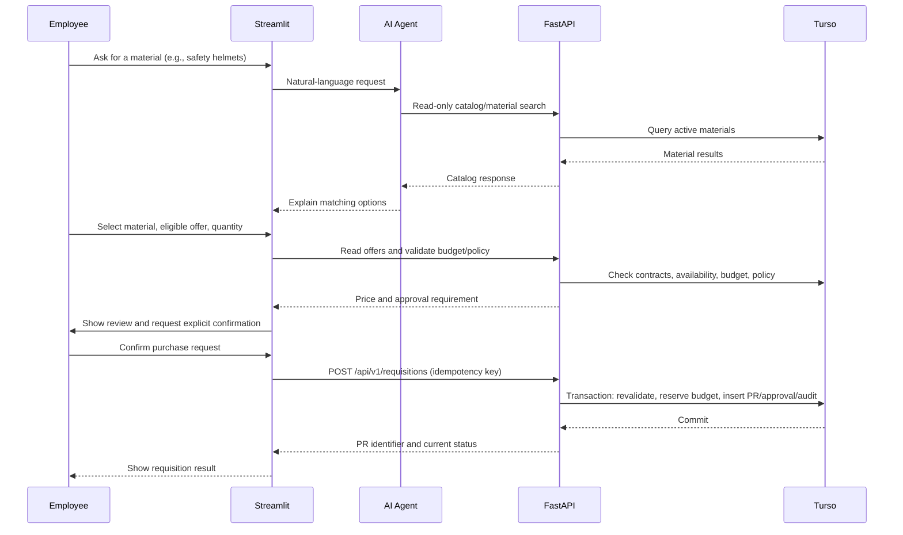

# ProcureAI — Solution Architecture

**Status:** As-built, local, single-process portfolio prototype (October 2026). This document distinguishes implemented features and validated behavior from production requirements.

## Design objective

ProcureAI demonstrates a governed procurement assistant in which natural-language interaction is separated from authoritative business execution. The AI agent interprets requests and uses approved **read-only tools**. The application and FastAPI backend control state-changing operations only after explicit human confirmation and fresh server-side validation.

This is a **portfolio prototype using synthetic procurement data**, not a production purchasing system.

## Component responsibilities

| Layer | Implemented technology | Responsibility |
|---|---|---|
| User interaction | Streamlit (`app.py`); CLI/API development paths | Conversation-first procurement journey: discover materials and offers, specify quantity, review validation, explicitly confirm, and see requisition status; separate manager demo approval/rejection view |
| AI reasoning | Microsoft Agent Framework with Azure-hosted GPT-5-mini | Interpret natural-language procurement questions and select approved read-only functions; explain results |
| Agent tools | `search_catalog`, `get_supplier_offers`, `validate_procurement_request` | Retrieve catalog, eligibility, and budget/policy information through FastAPI; no direct agent database mutations |
| Business/API layer | FastAPI (`api/main.py`, `api/requisitions.py`, `api/approvals.py`) | Validate offer, price, employee/cost center, policy and budget; create requisitions; manage approval decisions and audit records |
| Data layer | Turso/libSQL | Store catalog, supplier/contract eligibility, employee and cost center records, budgets, policies, requisitions, approvals, and audit events |
| Demo identity and model access | Environment-selected employee identities for API demo; Azure CLI credential for model access | Local developer/prototype mechanism only; **not production end-user authentication** |

## End-to-end procurement flow

For requests above the seeded **$500 approval threshold**, a manager approval request is created. The separate manager demo view can approve or reject; rejection releases the corresponding budget commitment. The actual write operations are performed by the backend, not by an autonomous agent tool.

## Transaction integrity and concurrency

The requisition API uses the following controls:

1. **Explicit confirmation:** requests without `confirmed: true` are rejected.
2. **Authoritative revalidation:** the backend checks active requester and cost center, eligible material/supplier/contract offer, price/currency, effective procurement policy, approval route, and current-year budget.
3. **Idempotency:** an idempotency key and request fingerprint prevent duplicate submissions from creating additional requisitions or commitments; conflicting reuse is rejected.
4. **Atomic transaction:** `BEGIN IMMEDIATE` groups budget reservation, requisition insertion, approval creation where needed, and audit insertion. A failure before commit triggers rollback.
5. **Conditional budget update:** the budget commitment is increased only when enough uncommitted funds remain; an insufficient-budget request returns HTTP 409.
6. **Single-process serialization:** a Python process-local lock serializes requisition submissions in the currently tested API process. This reduces simultaneous transaction conflicts in the local demo.
7. **Approval lifecycle:** manager actions are performed through backend authorization checks; rejection releases the reserved commitment, and repeat decisions are handled idempotently in tested scenarios.

**Concurrency boundary:** the process-local lock does **not** coordinate multiple Uvicorn workers, containers, replicas, or unrelated database writers. The conditional database update remains an important safety control, but distributed contention, retries, transient failures, and ambiguous commit outcomes require further architecture and testing before any production deployment. No claim is made that the prototype is multi-instance safe.

## Data model

The prototype uses the following 11 tables:

`materials`, `suppliers`, `contracts`, `supplier_catalog`, `cost_centers`, `employees`, `budgets`, `procurement_policies`, `purchase_requisitions`, `approval_requests`, `audit_logs`.

Supplier catalog offers reference materials and contracts; contracts associate suppliers. Requisitions reference requester, cost center, budget, offer and applicable policy. Approval requests and audit events reference requisitions. Consult `database/create_tables.py` for the executable schema and constraints.

Financial transaction amounts are handled in **integer cents**. The source supplier unit-price column uses `REAL`, which is a known modeling limitation for strict financial systems.

## API inventory

| Method and route | Purpose | Mutates data? |
|---|---|---|
| `GET /health` | Environment-aware health check | No |
| `GET /api/v1/materials?search=...` | Material discovery | No |
| `GET /api/v1/materials/{material_id}/supplier-offers` | Active eligible offers | No |
| `POST /api/v1/procurement/validate` | Read-only procurement validation | No |
| `POST /api/v1/requisitions` | Confirmed requisition creation | **Yes** |
| `POST /api/v1/approvals/{approval_id}/approve` | Manager approval | **Yes** |
| `POST /api/v1/approvals/{approval_id}/reject` | Manager rejection and budget release | **Yes** |

## Environment isolation

The development API uses `PROCUREAI_ENV=development` and the development Turso database (commonly port `8000`). The isolated transaction-test API uses `PROCUREAI_ENV=test`, `.env.test`, and the `procureai-test` Turso database (port `8001`). Environment configuration validates the expected test database identity and demo-write settings before test-mode operations. Local secrets are excluded from version control.

## Validation evidence — Stage 5

The full local pytest suite was reported **20/20 passing** after the concurrency fix, across:

| Test suite | Passing tests |
|---|---:|
| API and catalog | 4 |
| Transaction integrity | 5 |
| Negative governance | 6 |
| Identity and authorization | 2 |
| Concurrent budget requests | 1 |
| Rollback and recovery | 2 |
| **Total** | **20** |

The concurrency test demonstrated, in the single-process setup, one successful requisition (HTTP 201), one insufficient-budget rejection (HTTP 409), no overcommitment, and test-budget restoration. Recovery tests injected controlled failures during the requisition/approval creation transaction and verified rollback and safe retry behavior. These are **prototype test results**, not a performance, penetration, or multi-instance certification.

Reference test modules: `tests/test_procurement_api.py`, `test_transaction_integrity.py`, `test_negative_governance.py`, `test_identity_governance.py`, `test_concurrent_budget.py`, and `test_transaction_recovery.py`.

## Governance and production-readiness gaps

- **Identity:** demo employees are selected using server environment settings, not authenticated user sessions. Production requires enterprise SSO, authenticated API clients, authorization derived from verified claims, and least-privilege RBAC.
- **Distributed integrity:** replace or complement the in-process lock with database-coordinated contention management, bounded retries, timeout handling, and multi-instance tests. Define recovery for uncertain commit outcomes.
- **Agent safety:** add systematic evaluation of prompt injection, tool selection, hallucinated catalogs, malicious or ambiguous instructions, and human-confirmation bypass attempts. Agent tools should remain scoped to authorized operations.
- **Operations:** production-grade monitoring, structured traces, alerts, audit retention, rate limits, secrets rotation, deployment controls, and incident procedures are not demonstrated.
- **Financial modeling and integration:** strengthen price precision/validation; define ERP integration, reconciliation, status synchronization, and exception handling before connecting to real procurement systems.
- **Security and performance:** independent security testing, load testing, data protection, and disaster-recovery practices remain future requirements.

## Planned evolution

Prioritize AI-agent evaluation, governance hardening, enterprise identity, and distributed transaction resilience before external production integrations. Future additions may include MCP-based connectors, ERP integration, multi-line requisitions, monitoring and richer evaluation pipelines. Voice input is explicitly **out of scope** for the current milestone. A multi-agent architecture is not required for the current MVP.
